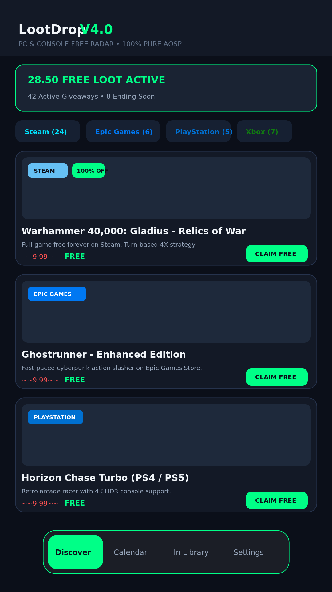
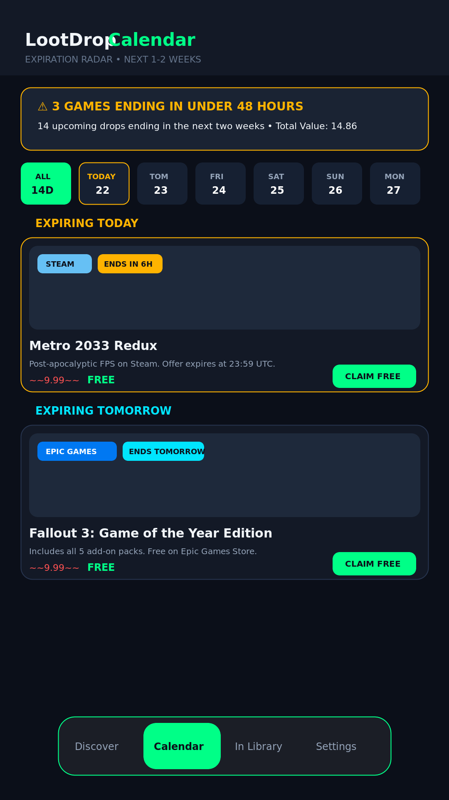
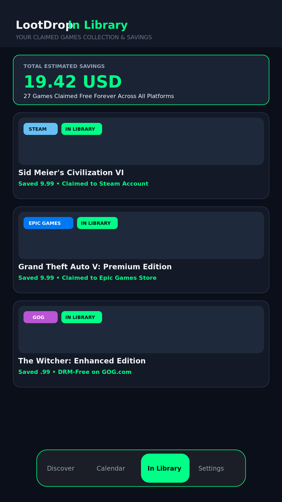
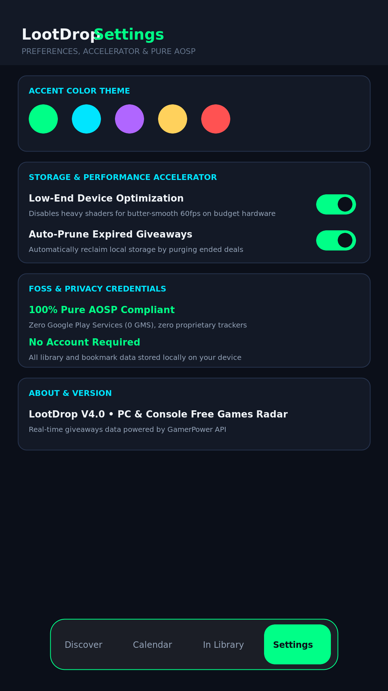

# LootDrop 🎮

[](https://opensource.org/licenses/MIT)
[]()
[]()

**LootDrop** is a 100% Free and Open Source (FOSS) Android app built with Jetpack Compose that tracks 100% free PC and console games, DLCs, and loot drops in real-time.

Designed specifically for **F-Droid** and **pure AOSP** devices with **zero Google Mobile Services (0 GMS)** dependencies, zero telemetry, and zero accounts required.

---

## 🌟 Key Features

- **🎯 Free Games Radar (Discover Tab)**: Real-time feed of 100% discount promotions on Steam, Epic Games Store, GOG, Prime Gaming, PlayStation 5/4, Xbox Series X|S, Nintendo Switch, Ubisoft, and DRM-Free sources.
- **📅 Expiration Calendar (Calendar Tab)**: Interactive day-by-day timeline spanning the next 1–2 weeks so you never miss a free drop before it expires. Includes urgent countdown alerts for deals ending in ≤ 48 hours.
- **📚 In Library & Dollar Tracker (In Library Tab)**: Track every claimed title and calculate your cumulative dollar savings automatically.
- **⚡ Storage & Performance Accelerator**: Low-end device optimization mode, disk cache control, and zero battery drain alarms.
- **🎨 Material 3 Expressive Design**: Fluid gesture navigation bar, customizable theme palettes (Emerald, Cyber Cyan, Neon Purple, Sunset Gold), and dark/light modes.
- **🔒 Privacy First**: Offline-first architecture powered by Room Database. No account creation, no analytics, no external tracking.

---

## 📸 Screenshots

| Discover Radar | Expiration Calendar | In Library Savings | Settings & Themes |
|:---:|:---:|:---:|:---:|
|  |  |  |  |

---

## 📦 F-Droid & Fastlane Metadata

This repository contains the full Fastlane metadata structure required for F-Droid client indexing:
```
fastlane/metadata/android/en-US/
├── title.txt
├── short_description.txt
├── full_description.txt
└── images/
    ├── icon.png (512x512)
    ├── featureGraphic.png (1024x500)
    └── phoneScreenshots/
        ├── 1_discover.png
        ├── 2_calendar.png
        ├── 3_library.png
        └── 4_settings.png

metadata/
└── com.aistudio.lootdrop.fkgxwm.yml (F-Droid Build Recipe)
```

---

## 🛠️ Building from Source

This project builds with standard Gradle:

```bash
# Debug APK
gradle assembleDebug

# Release APK
gradle assembleRelease

# Run unit tests
gradle :app:testDebugUnitTest
```

---

## 📜 License

Distributed under the **MIT License**. See `LICENSE` for details.
All giveaway data is provided openly via the [GamerPower API](https://www.gamerpower.com/api-reference).
